<h1 align="center">✨ Hej hej ✨</h1>

  

---
# I'm Alessio Galatolo, welcome to my profile!

- 👋 Hi, I’m @alessioGalatolo
- 💼 PhD student at Uppsala University
- 🦉 MSc in Machine Learning
- 📚 BSc in Computer Science
- 🌱 Working on LLMs and Social Robots
- 💞️ Want to collaborate? Send me an [email](mailto:alessio.galatolo@it.uu.se)!
- 🌐 [My website](https://www.alessiogalatolo.com/)
- 🎓 [Scholar Profile](https://scholar.google.com/citations?hl=en&user=Wyw_fPIAAAAJ)
- ⚡ Fun fact: I'm a huge fan of [chocolate strawberry mooncakes](https://leagueoflegends.fandom.com/wiki/Zoe/LoL/Audio#:~:text=%22CHOCOLATE%20STRAWBERRY%20CAKE!!%22)
---

## 📚 Recent Publications
<!-- START_SCHOLAR -->
- 📄 [The Hidden Cost of Personality: How Conditioning Methods Disrupt Gesture Generation in Small Language Models](https://scholar.google.com/citations?view_op=view_citation&hl=sv&user=Wyw_fPIAAAAJ&pagesize=8&sortby=pubdate&citation_for_view=Wyw_fPIAAAAJ:UebtZRa9Y70C) (Proceedings of the 1st Workshop on Multimodal Interaction in Face-to-Face …, 2026, 2026)
- 📄 [Low-Resource Preference Adaptation of LLMs via Activation-Based Label Propagation](https://scholar.google.com/citations?view_op=view_citation&hl=sv&user=Wyw_fPIAAAAJ&pagesize=8&sortby=pubdate&citation_for_view=Wyw_fPIAAAAJ:roLk4NBRz8UC) (EMNLP Main, 2026, 2026)
- 📄 [Lightweight Visual Reasoning for Socially-Aware Robots](https://scholar.google.com/citations?view_op=view_citation&hl=sv&user=Wyw_fPIAAAAJ&pagesize=8&sortby=pubdate&citation_for_view=Wyw_fPIAAAAJ:LkGwnXOMwfcC) (ICRA 26, 2026, 2026)
- 📄 [Beyond Ethical Alignment: Evaluating LLMs as Artificial Moral Assistants](https://scholar.google.com/citations?view_op=view_citation&hl=sv&user=Wyw_fPIAAAAJ&pagesize=8&sortby=pubdate&citation_for_view=Wyw_fPIAAAAJ:YsMSGLbcyi4C) (European Conference on Artificial Intelligence (ECAI) 413, 1213 - 1220, 2025, 2025)
<!-- END_SCHOLAR -->
